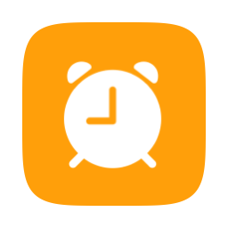

<p align="center">
  
</p>

<h1 align="center">Wake Up Human</h1>

<p align="center">
  A menu-bar alarm for your Mac that only stops when you type.
</p>

<p align="center">
  <a href="https://github.com/Octaviocossy/wake-up-human/actions/workflows/ci.yml"></a>
  <a href="https://github.com/Octaviocossy/wake-up-human/releases/latest"></a>
  
  
</p>

Wake Up Human is a small, native macOS menu-bar alarm clock with no snooze button. When an Alarm
rings, a window covers the screen with six random words, and the only way to Dismiss the Ring is
to type them. By the time you have, you are awake. An optional Bedtime mode plays soft generated
rain while you fall asleep and keeps the Mac awake for the morning.

> [!IMPORTANT]
> An Alarm rings only if the Mac is awake. Turn on Bedtime at night, leave the lid open and keep
> the Mac plugged in: the app never wakes a sleeping Mac. See
> [Before you rely on it](#before-you-rely-on-it).

<p align="center">
  
  
</p>

## Features

- Set several Alarms, each a time plus the weekdays it repeats on. An Alarm with no weekday rings
  once, then Disarms itself.
- Dismiss a Ring only by retyping six random words, letter for letter, with live feedback as you
  type. Pasting or dropping text never fills it, and there is no snooze.
- Never miss a Ring because the Mac was muted: the app unmutes the system output and ramps it to
  full volume over about 30 seconds, then restores your volume and mute state after the Dismiss.
- Fall asleep to Bedtime's generated rain, with its own volume slider, while it keeps the Mac out
  of System sleep until you switch it off or a Ring replaces it.
- See what needs attention in the panel: Notices for a missed Occurrence, a Ring nobody answered
  (it stops by itself after 60 minutes), Bedtime off with an Alarm due within 12 hours, and
  Bedtime on battery.
- Launch at login, on by default, and stay out of the way: menu bar only, no Dock icon.
- Keep everything on your Mac: no network calls, no accounts, no analytics. Sounds are generated
  in code; there are no audio files and no third-party dependencies.

The interface and the typing words are in Spanish.

## Requirements

- macOS 26 Tahoe or later
- An Apple Silicon or Intel Mac
- For an Alarm to ring: the Mac awake (Bedtime on), the lid open and the Mac on power

## Install

1. Download the latest `.dmg` from [GitHub Releases](https://github.com/Octaviocossy/wake-up-human/releases/latest).
2. Open the disk image and drag **WakeUpHuman** into **Applications**.
3. Open WakeUpHuman from `/Applications`.

Published builds are ad-hoc signed, not signed with an Apple Developer ID, and not notarized.
macOS will therefore block the first launch. Open **System Settings > Privacy & Security**, find
the message about WakeUpHuman, and select **Open Anyway**. Alternatively, remove the quarantine
attribute in Terminal:

```sh
xattr -dr com.apple.quarantine /Applications/WakeUpHuman.app
```

Control-clicking the app and choosing Open no longer bypasses this warning. The signing decision
and its rationale are recorded in decision 28 of
[the macOS spec](.agents/specs/2026-11-01-macos-typing-alarm.md).

Installing the app in `/Applications` is also required for reliable **Launch at Login**, which is
on by default.

## Usage

| Action | Result |
| --- | --- |
| Click the menu-bar icon | Open or close the panel |
| Turn on **Modo dormir** | Start Bedtime: rain plays and the Mac stays out of System sleep |
| Drag the **Lluvia** slider | Set the rain volume, independently of the system volume |
| Click **Nueva alarma** | Add an Alarm, starting at 07:00 with no weekday |
| Click an Alarm's time | Edit it inline: time and weekdays, then **Guardar** or **Eliminar** |
| Flip an Alarm's switch | Arm or Disarm it. Disarming never asks for the Typing challenge |
| Type the six words in the Ring window | Dismiss the Ring; no Enter needed |
| Click **Entendido** on a Notice | Acknowledge it |

|  |  |  |  |  |
| --- | --- | --- | --- | --- |
| No Alarm Armed | An Alarm Armed | Bedtime on | A Notice is waiting | A Ring is sounding |

While a Ring sounds, the panel offers no Quit. Force Quit stays available as the emergency exit if
the app itself misbehaves.

## Before you rely on it

An alarm that does not ring is worse than no alarm. Read this once.

- **Turn on Bedtime at night.** It is the only thing that keeps the Mac out of System sleep while
  it waits for an Alarm. An Alarm Armed without Bedtime rings only if the Mac happens to be awake.
- **Leave the lid open and the Mac plugged in.** A MacBook enters System sleep when its lid closes,
  whatever any app asks. The panel shows a Notice when Bedtime runs on battery.
- **The app never wakes a sleeping Mac.** It schedules no wake and installs no privileged helper
  ([ADR-0027](.agents/adr/0027-only-bedtime-keeps-the-mac-awake.md)). An Occurrence that passes
  during System sleep, or while the app is not running, is reported as missed and never rung late.
- **FileVault restarts stop at the login screen.** If the Mac restarts overnight (for example for a
  macOS update), no app runs until you log in, so that morning's Alarm cannot ring.
- **A locked screen comes first.** If the Mac locks when the display turns off, the Ring still
  sounds; unlock it, then type.
- **Bluetooth speakers may power off.** macOS then routes the Ring to the Mac's built-in speakers.
  Bedtime's continuous rain keeps most speakers awake.

## Build From Source

Development requires:

- Xcode 26 or later
- [XcodeGen](https://github.com/yonaskolb/XcodeGen): `brew install xcodegen`

Clone the repository and generate the Xcode project:

```sh
git clone https://github.com/Octaviocossy/wake-up-human.git
cd wake-up-human
xcodegen generate
open WakeUpHuman.xcodeproj
```

Run the `WakeUpHuman` scheme from Xcode, or build, test and lint from Terminal:

```sh
xcodebuild -scheme WakeUpHuman -destination 'platform=macOS' build
xcodebuild -scheme WakeUpHuman -destination 'platform=macOS' test
swift format lint --strict --recursive WakeUpHuman WakeUpHumanTests
```

`WakeUpHuman.xcodeproj` and the app entitlements are generated from `project.yml` and are not
committed ([ADR-0026](.agents/adr/0026-xcodegen-generates-the-project.md)). Run `xcodegen generate`
before every `xcodebuild` invocation in a fresh checkout.

To check at runtime which power assertions the app holds (while Bedtime is on, or during a Ring):

```sh
pmset -g assertions | grep "Wake Up Human"
```

Logs use the unified logging subsystem `com.ovct.wakeuphuman`:

```sh
log stream --predicate 'subsystem == "com.ovct.wakeuphuman"'
```

## How It Works

Wake Up Human is built with Swift 6, using AppKit for the menu-bar shell and the Ring window,
SwiftUI for the panel, AVAudioEngine for the generated alarm tone and rain, CoreAudio for the
system volume, IOKit power assertions (`PreventUserIdleSystemSleep` while Bedtime is on,
`PreventUserIdleDisplaySleep` during a Ring), and `SMAppService` for launch at login. Alarms are
stored in `UserDefaults`. The app is sandboxed and has no package dependencies.

```text
WakeUpHuman/          Application source, the bundled word list and assets
WakeUpHumanTests/     Swift Testing test target
Tools/                App icon tooling
docs/design/          The prototype's screens, the visual reference
project.yml           XcodeGen project definition
.github/workflows/    Continuous integration and release automation
```

Product behavior is settled in [`.agents/specs/`](.agents/specs/), architecture decisions in
[`.agents/adr/`](.agents/adr/), the domain vocabulary in
[`.agents/ubiquitous-language.md`](.agents/ubiquitous-language.md) and the product's invariants in
[`.agents/ubiquitous-language-invariants.md`](.agents/ubiquitous-language-invariants.md).
Maintainer and agent workflow guidance starts in [`AGENTS.md`](AGENTS.md) and
[`.agents/docs/workflow.md`](.agents/docs/workflow.md).

## Non-goals

These are deliberate. Pull requests that add them will be closed.

- **Snooze**, in any form. A wake-up app with a snooze button is a snooze app.
- **Network access**: no backend, accounts, sync or analytics. Alarms and settings never leave the
  Mac ([product invariants](.agents/ubiquitous-language-invariants.md)).
- **Waking a sleeping Mac**: no scheduled wake, no privileged helper
  ([ADR-0027](.agents/adr/0027-only-bedtime-keeps-the-mac-awake.md)).
- **Developer ID signing, notarization or the Mac App Store.**
- **Audio files**: the alarm tone and the rain are generated in code.

## Contributing

Issues and pull requests are welcome, in English (Spanish is fine too). Read
[CONTRIBUTING.md](CONTRIBUTING.md) before opening a pull request, and report security issues
privately as described in [SECURITY.md](SECURITY.md).

## Releasing

Tags matching `vMAJOR.MINOR.PATCH` trigger the release workflow. It tests the app, builds a
universal (Apple Silicon and Intel) Release configuration, signs it ad hoc, packages it as a DMG
and publishes a GitHub Release. Published versions come from the tag rather than the development
defaults in `project.yml`.

## License

Released under the [MIT License](LICENSE). You are free to use, modify and redistribute the code,
including commercially, provided the copyright notice and license text travel with it.

Copyright © 2026 Octavio Cossy Torquati.

See also [Caffeinassy](https://github.com/Octaviocossy/caffeinassy), a sibling menu-bar app that
keeps your Mac's display awake.
