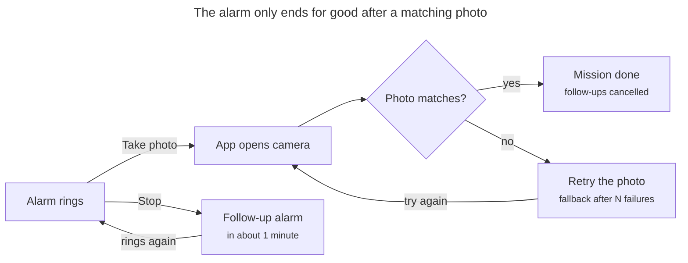

# Photo Alarm — Product Brief (Setup & MVP)

Oct 31, 2026 · @Octavio Cossy Torquati

## Overview

Photo Alarm is a personal iOS alarm clock that only stops for good once I photograph a pre-registered object, such as a Coca-Cola bottle kept in another room. It targets one user on one iPhone: no App Store, no accounts, no backend.

The MVP goal is a build running on my own iPhone that wakes me reliably every morning and forces me out of bed to complete the photo mission.

The MVP is done when:

- The alarm rings with the phone locked, silenced, in a Focus and with the app closed.
- Stopping the alarm without the photo brings it back within about a minute.
- The registered object passes the check and other objects fail it.
- The app uses no battery overnight, because it does not run in the background.

## MVP scope

The MVP covers one target object, weekly alarms and the photo mission; everything else waits.

**In scope**

- Register one target object with 3 to 5 reference photos.
- Create, edit, enable and disable alarms: a time plus weekday repeats.
- Wake-up mission: live camera capture and an on-device match against the references.
- Re-alarm loop: the alarm keeps coming back until the mission is completed.
- Emergency fallback after several failed attempts, in case the object is missing.
- Re-schedule every alarm on each app launch.

**Out of scope**

- Several objects, or a different object per alarm.
- Custom alarm sounds (the system default is enough for the MVP).
- Picking photos from the library, iCloud sync, widgets beyond what AlarmKit requires.
- App Store distribution, analytics, onboarding, localization, Android.

## Core user flows

The wake-up mission is the heart of the app: the alarm only ends for good after a matching photo.

**Object setup (once)**

1. Open the setup screen and take 3 to 5 photos of the object from different angles and lighting.
2. The app computes and stores a feature print for each photo.
3. Take a test photo to confirm the object passes before relying on it.

**Scheduling an alarm**

1. Pick a time and the weekdays it repeats on.
2. The app asks for AlarmKit permission on first use and schedules the alarm with the system.

**Wake-up mission**

1. The alarm rings through the system UI, with a Stop button and a secondary "Take photo" button.
2. Stop without a completed mission: the alarm returns about a minute later.
3. Take photo: the app opens straight into the camera, captures a live photo and checks it against the references.
4. Match: the mission is marked done and every follow-up alarm is cancelled. No match: retry, and the loop keeps running.



Stop only buys about a minute; the loop ends when a photo matches or the fallback is completed.

**Emergency fallback**

After several failed attempts in one session, the mission screen offers a long challenge (for example, a series of math problems) that also completes the mission. It covers a lost or moved object.

## Technical approach

The app does not run overnight: the system rings the alarm, and app code runs only when an alarm is scheduled, when an alarm button fires an intent, or when the app is opened for the mission. All mission state must therefore be persisted, never held in memory.

| Concern | Choice | Notes |
| --- | --- | --- |
| UI | SwiftUI | iOS 26 deployment target |
| Alarms | AlarmKit: `AlarmManager`, `AlarmConfiguration.alarm`, `Alarm.Schedule.relative` with weekly repeats | Rings through silent mode and Focus; the alert UI is drawn by the system |
| Alarm buttons | App Intents: `StopAlarmIntent` and `OpenMissionIntent`, both `LiveActivityIntent` | Stop re-schedules a one-off alarm about a minute later if the mission is not done; the secondary button opens the app in mission mode |
| Camera | `UIImagePickerController` wrapped in `UIViewControllerRepresentable`, camera source only | Move to `AVCaptureSession` only if the picker gets in the way |
| Object match | Vision: `VNGenerateImageFeaturePrintRequest` + `computeDistance` | Pass when the smallest distance to any reference is under a threshold calibrated on device |
| Extra check (optional) | Vision: `VNRecognizeTextRequest` | E.g. require the brand text on the label |
| Data | SwiftData for alarms and reference feature prints (archived as `Data`) |  |
| Mission state | Small store in an App Group container | Read by the app, the intents and any extension |

**Re-alarm loop**

- Each ring starts a wake-up session with an id and a `missionCompleted` flag.
- `StopAlarmIntent.perform`: if the session is not completed, schedule a one-off follow-up alarm (`.fixed(now + ~60 s)`) with the same intents.
- On a successful match: set `missionCompleted`, cancel all follow-up alarms, keep the recurring base alarm.

**Matching**

- References: 3 to 5 photos, varied angle and light, object filling most of the frame.
- Compare a new photo against every reference and keep the smallest distance.
- Calibrate the threshold from logged distances: the target object versus several other objects, in morning light.

## Initial setup

Setup needs a Mac with Xcode 26 or later, an iPhone on iOS 26 or later, and an Apple ID; everything is tested on the real device.

**Signing:** a free Apple ID (Personal Team) is enough to develop, but its builds expire after 7 days. For daily use as my only alarm, the paid Apple Developer Program (USD 99/year) gives one-year builds and TestFlight.

**Steps**

1. Create an Xcode project: iOS App, SwiftUI, Swift, named `PhotoAlarm`, bundle id `com.<me>.photoalarm`, deployment target iOS 26.0.
2. Signing & Capabilities: select my team with automatic signing; add the App Groups capability (`group.com.<me>.photoalarm`).
3. Info.plist keys:
   - `NSAlarmKitUsageDescription`: without it, AlarmKit cannot schedule alarms.
   - `NSCameraUsageDescription`: required for the camera.
4. On the iPhone: enable Developer Mode (Settings > Privacy & Security) and trust the developer certificate after the first install.
5. Initialize a git repo with an Xcode `.gitignore`.

**Folder structure**

```
PhotoAlarm/
  App/              PhotoAlarmApp.swift
  Features/
    Alarms/         list + editor screens
    ObjectSetup/    reference photo capture
    Mission/        wake-up mission + fallback
  Alarm/            AlarmScheduler.swift, AlarmMetadata.swift
    Intents/        StopAlarmIntent.swift, OpenMissionIntent.swift
  Vision/           ObjectMatcher.swift
  Camera/           CameraPicker.swift
  Persistence/      Models.swift, MissionStateStore.swift
  Debug/            spike screens (debug builds only)
```

## Build plan

Build the two riskiest pieces first as throwaway spikes (alarm reliability, then photo matching), and only then the real flow and UI. Each milestone ends with a check on the iPhone.

1. **M0 — Project setup.** Project, capabilities and plist keys from Initial setup.
   - Done when: an empty app installs and launches on my iPhone.
2. **M1 — AlarmKit spike.** A debug screen with "Alarm in 1 minute"; `StopAlarmIntent` re-schedules a follow-up.
   - Done when: it rings locked, silenced, in a Focus, with the app force-quit and after a reboot; Stop brings it back about a minute later.
3. **M2 — Vision spike.** A debug screen that captures references, then shows the distance for each new photo.
   - Done when: distances are logged for the target and at least five other objects in two or three lighting conditions, and a threshold is chosen.
4. **M3 — Mission flow.** The secondary button opens the mission; a match ends the loop; failures keep it running; the fallback unlocks after several failures.
   - Done when: a full wake-up works end to end with the phone locked.
5. **M4 — Alarm management.** List, create, edit and toggle weekly alarms in SwiftData; re-schedule everything on launch.
   - Done when: alarms survive app restarts and reboots and ring on the right days.
6. **M5 — Daily-use hardening.** Run the on-device checklist and use the app for a week next to a backup alarm in the Clock app.
   - Done when: a week passes with no missed or stuck alarm.

## On-device test checklist

Run this on the iPhone after M1, after M3, and again after every iOS update.

- [ ] Rings with the phone locked
- [ ] Rings in silent mode
- [ ] Rings with the Sleep Focus on
- [ ] Rings with the app force-quit
- [ ] Rings after a reboot, with the button titles shown correctly
- [ ] Rings after an iOS update (open the app once first so it re-schedules)
- [ ] Rings while another app is open in landscape
- [ ] Rings with Low Power Mode on
- [ ] Stop without a photo: the alarm returns about a minute later
- [ ] The target object passes in dim morning light
- [ ] Other objects, including similar bottles, fail
- [ ] The fallback unlocks after 5 failed photo checks; 15 correct answers end the alarm
- [ ] While the mission screen is open no Follow-up rings; locking the phone brings one within about a minute
- [ ] "Take photo" then leaving the app without a match brings a Follow-up
- [ ] Photo Alarm is not hidden and does not require Face ID or a passcode to open (AlarmKit alarms of such apps fail silently)
- [ ] The expiry banner shows the right number of days; reinstall before it reaches 0
- [ ] Re-run the dismissal table in `docs/alarmkit-findings.md` after each iOS update
- [ ] Settings > Battery shows no background use for the app

## Risks and open decisions

The biggest risk is AlarmKit itself: it is new, and developers have reported alarms that silently stopped ringing. Every mitigation below assumes a backup alarm in the Clock app during the first weeks.

| Risk | Mitigation |
| --- | --- |
| Alarms stopped ringing after an iOS update ([report](https://origin-devforums.apple.com/forums/thread/809398)) | Re-schedule all alarms on every launch; open the app after each iOS update |
| Alarm button titles showed raw localization keys after a reboot ([report](https://developer.apple.com/forums/thread/802740)) | Use plain literal strings, no custom localization keys; test after a reboot |
| Alarm alert did not appear while an app was open in landscape ([report](https://developer.apple.com/forums/thread/806681)) | Keep it on the test checklist; rely on the follow-up loop |
| The system Stop button cannot be blocked | Stop and "Take photo" arm a Follow-up; a dismissal that runs no intent ends the loop on purpose (ADR-0025) |
| Free signing expires after 7 days | In-app expiry banner (red at ≤2 days) and a weekly calendar reminder |
| A hidden or Face ID-locked app's alarms fail silently (AlarmKit FAQ) | Never hide or lock Photo Alarm; checklist item |
| Matching fails in low light (false negatives) | Several references, retries, emergency fallback |
| Matching accepts the wrong object, or a photo of the object | Accepted for personal use; optional label-text check |
| The object gets lost or thrown away | Emergency fallback; re-register a new object |

**Open decisions**

Resolved in `.agents/specs/2026-10-31-photo-alarm-mvp.md`.

## Notes for Claude Code

Work one milestone at a time and stop after each one: I verify on the iPhone before the next starts.

- Swift 6, SwiftUI, iOS 26 deployment target, no third-party dependencies for the MVP.
- Check AlarmKit signatures against Apple's current docs before writing code: the API is new and has changed between releases (iOS 27 adds an `AlarmConfiguration` initializer with `appEntityIdentifier`).
- Keep AlarmKit behind an `AlarmScheduler` protocol and Vision behind an `ObjectMatcher` protocol, so the mission logic can be unit-tested with fakes.
- Build and run unit tests with `xcodebuild`; anything involving the camera or real alarms is tested manually on the device.
- Camera source only: never read from the photo library.
- Alarm titles and button labels are plain literal strings.
- In debug builds, log every match distance with `os.Logger` for threshold calibration.
- Code, comments and docs in English.

## Sources

- [Scheduling an alarm with AlarmKit](https://developer.apple.com/documentation/alarmkit/scheduling-an-alarm-with-alarmkit) — Apple sample and plist requirement
- [AlarmConfiguration.alarm(schedule:attributes:stopIntent:secondaryIntent:sound:)](<https://developer.apple.com/documentation/alarmkit/alarmmanager/alarmconfiguration/alarm(schedule:attributes:stopintent:secondaryintent:sound:)>) — stop and secondary intents
- [AlarmConfiguration init with appEntityIdentifier (iOS 27)](<https://developer.apple.com/documentation/alarmkit/alarmmanager/alarmconfiguration/init(countdownduration:schedule:attributes:appentityidentifier:stopintent:secondaryintent:sound:)>)
- [Alarms stop ringing after an iOS update](https://origin-devforums.apple.com/forums/thread/809398)
- [Alarm UI strings lost after reboot](https://developer.apple.com/forums/thread/802740)
- [Alarms not firing with a landscape app in front](https://developer.apple.com/forums/thread/806681)
